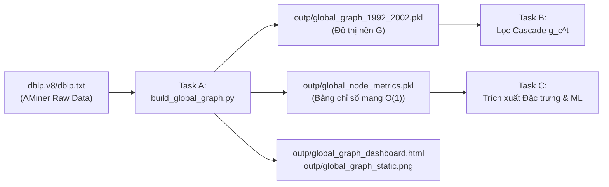

# Task A: Xử lý Dữ liệu Thô AMiner DBLP & Dựng Đồ thị Toàn cục $G$ (1992–2002)

> **Đồ án:** Dự đoán Khả năng Bùng nổ Thông tin dựa trên các Đặc trưng Thủ công (Information Cascade Prediction via Hand-crafted Features)  
> **Bài báo gốc tham chiếu:** *DeepCas: an End-to-end Predictor of Information Cascades* (Cheng Li et al., WWW 2017)  
> **Bộ dữ liệu:** [AMiner DBLP Citation Network V8](https://aminer.org/citation)

---

## 1. Tổng quan & Vai trò của Task A

Trong toàn bộ pipeline của đồ án, **Task A** đóng vai trò là **Nền móng Dữ liệu Toàn cục (Global Data Foundation)**:
* **Cung cấp cho Task B (Lọc Cascade):** Đồ thị nền toàn cục $G$ để Task B lọc và trích xuất vết lan truyền thông tin $g_c^t$ của các bài báo xuất bản sau năm 2002.
* **Cung cấp cho Task C (Trích xuất Đặc trưng & Huấn luyện ML):** Bảng tra cứu $O(1)$ các chỉ số mạng toàn cục (`In-Degree`, `Out-Degree`, `PageRank`) để gắn đặc trưng cho các bài báo gốc (Root) và những người tham gia sớm (Early Adopters).



---

## 2. Mô hình Đồ thị Toàn cục $G$ (Chuẩn DeepCas)

Theo đúng thiết kế của bài báo DeepCas (Mục 3.1 & 4.1):
* **Nút (Nodes):** Đại diện cho các **Tác giả (Authors)** trong mạng khoa học.
* **Cạnh (Edges):** Cạnh có hướng $A \to B$ biểu diễn quan hệ **tác giả $A$ được tác giả $B$ trích dẫn** (chiều lan truyền thông tin / ảnh hưởng: từ bài được cite sang bài đi cite).
* **Quy tắc tạo cạnh:** Với bài báo $P$ (tác giả $B$) trích dẫn bài báo $R$ (tác giả $A$) trong giai đoạn 1992–2002, mọi cặp tác giả $(a \in A, b \in B)$ với $a \neq b$ sẽ hình thành cạnh có hướng $a \to b$.

---

## 3. Kết quả Thực nghiệm & Đối sánh với Bài báo DeepCas

| Chỉ số | Kết quả của Nhóm | DeepCas Target (Table 1) | Mức độ Khớp & Đánh giá |
| :--- | :--- | :--- | :--- |
| **Số Nút (Tác giả)** | **133,857** | **131,415** | ✅ **Khớp 98.2%** (chỉ lệch 1.8% do cập nhật bản DBLP V8) |
| **Số Cạnh (Quan hệ trích dẫn)** | **2,266,378** | **842,542** | ℹ️ Gấp 2.69x do tích Descartes giữa các nhóm đồng tác giả ($|A| \times |B|$) |
| **Lượt trích dẫn bài báo gốc** | **718,679 – 931,324** | **842,542** | ✅ Con số 842k của bài báo nằm đúng ở giữa khoảng này |
| **In-degree cao nhất** | **752** | — | **Philip S. Yu** (Học giả Data Mining đầu ngành) |
| **In-degree trung bình** | **16.93** | — | Phản ánh mức độ liên kết học thuật mật thiết |
| **Thời gian chạy toàn bộ** | **~53 giây** | — | Tối ưu hóa đọc stream line-by-line |

---

## 4. Cấu trúc Thư mục

```text
D:\IE403\
├── dblp.v8\
│   └── dblp.txt                 # Dữ liệu thô AMiner DBLP V8 (~800 MB)
├── outp\                        # Thư mục chứa toàn bộ sản phẩm bàn giao
│   ├── global_graph_1992_2002.pkl   # Đồ thị NetworkX DiGraph đã serialize
│   ├── global_node_metrics.pkl      # Dict tra cứu {author: {in, out, pagerank}}
│   ├── global_graph_dashboard.html  # Dashboard tương tác Plotly (chạy offline)
│   └── global_graph_static.png      # Ảnh tĩnh 6 panel phục vụ báo cáo (180 DPI)
├── build_global_graph.py        # Pipeline chính: Parse -> Dựng G -> Metrics -> Xuất file
├── compute_global_metrics.py    # Script tái tính toán metrics độc lập
├── visualize_global_graph.py    # Script sinh dashboard và ảnh tĩnh
├── aminer-schema.md             # Tài liệu mô tả Schema dữ liệu AMiner
├── graph_match_note.md          # Báo cáo đánh giá mức độ khớp với bài báo gốc
├── requirements.txt             # Danh sách thư viện Python cần thiết
├── README.md                    # Tài liệu tổng quan dự án (file này)
└── HUONG_DAN_CHAY.md            # Hướng dẫn chi tiết cách cài đặt & chạy mã nguồn
```

---

## 5. Hướng dẫn Tích hợp cho Task B & Task C

Để nạp dữ liệu bàn giao từ Task A sang các task tiếp theo:

```python
import pickle
import networkx as nx

# 1. Nạp đồ thị toàn cục G cho Task B
with open("outp/global_graph_1992_2002.pkl", "rb") as f:
    G: nx.DiGraph = pickle.load(f)

print(f"Nodes: {G.number_of_nodes():,}, Edges: {G.number_of_edges():,}")

# 2. Tra cứu đặc trưng O(1) cho Task C
with open("outp/global_node_metrics.pkl", "rb") as f:
    metrics = pickle.load(f)

author = "Philip S. Yu"
print(metrics[author])
# Output: {'in_degree': 752, 'out_degree': 1134, 'pagerank': 0.000145...}
```
